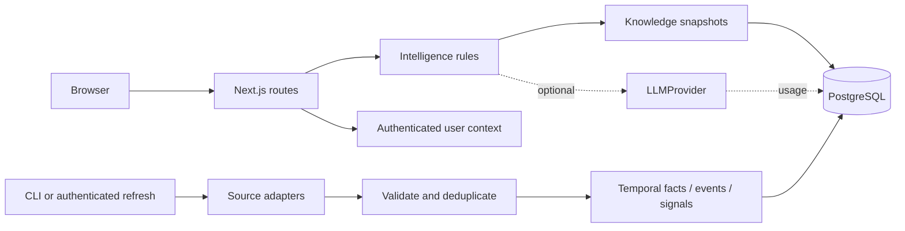

# Architecture

## Modular monolith

Next.js 16.4 App Router + React 19.2.8 + TypeScript 7.0.2。一个 Node.js 服务，SQL 数据仓库和可独立执行的抓取入口。Windows 默认 PGlite 0.5.8（持久化 PostgreSQL WASM）；配置 DATABASE_URL 后使用 pg 连接标准 PostgreSQL。

| Module | Responsibility |
|---|---|
| `app` / `components` | Server-rendered routes, accessible browser controls, status semantics |
| `lib/intelligence.ts` | Pure intent, relevance, trends, comparison support and decision rules |
| `lib/knowledge.ts` | SQL snapshot reconstruction and user-scoped context reads |
| `lib/research.ts` | Traceable staged composition and evidence cache |
| `lib/adapters/*` | One module per source protocol; fixed allowlist and bounded fetch |
| `lib/ingestion.ts` | Validation, deduplication, temporal updates, observations and signals |
| `lib/db.ts` / `db/migrations` | SQL interface, transactions, migration ledger, single-process lock |
| `lib/auth.ts` | Password hashing, opaque sessions, database rate limits and audit |
| `lib/llm` | Provider registry, structured output validation and usage ledger |

Current graph traversals use relational edges, not a graph database. Search uses canonical IDs, bilingual aliases and deterministic matching; no vector search or claim of general semantic search. Shared evidence caches exclude personal context. User relevance is computed after cache lookup.

Jobs run in small batches with a PostgreSQL lock and deadline. No Redis is justified at present. Production needs a separate process using the same monolith code, durable retries and scheduling; current HTTP refresh is bounded but synchronous. All source logic remains behind adapters.

Standard PostgreSQL needs a production migration lock/runner and independently configured pooled roles before multi-instance deployment. PGlite rejects concurrent process access. Every runtime page is dynamic; no static build worker opens the database. Runtime keys are never serialized into React.

The Sites build/hosting workflow was evaluated. Its Cloudflare Worker constraints and database binding choices do not provide the requested local persistent PostgreSQL runtime. This deliverable preserves the user's stable Next.js, Windows and PostgreSQL requirements. No Site was registered, no source uploaded and no public deployment claimed.
